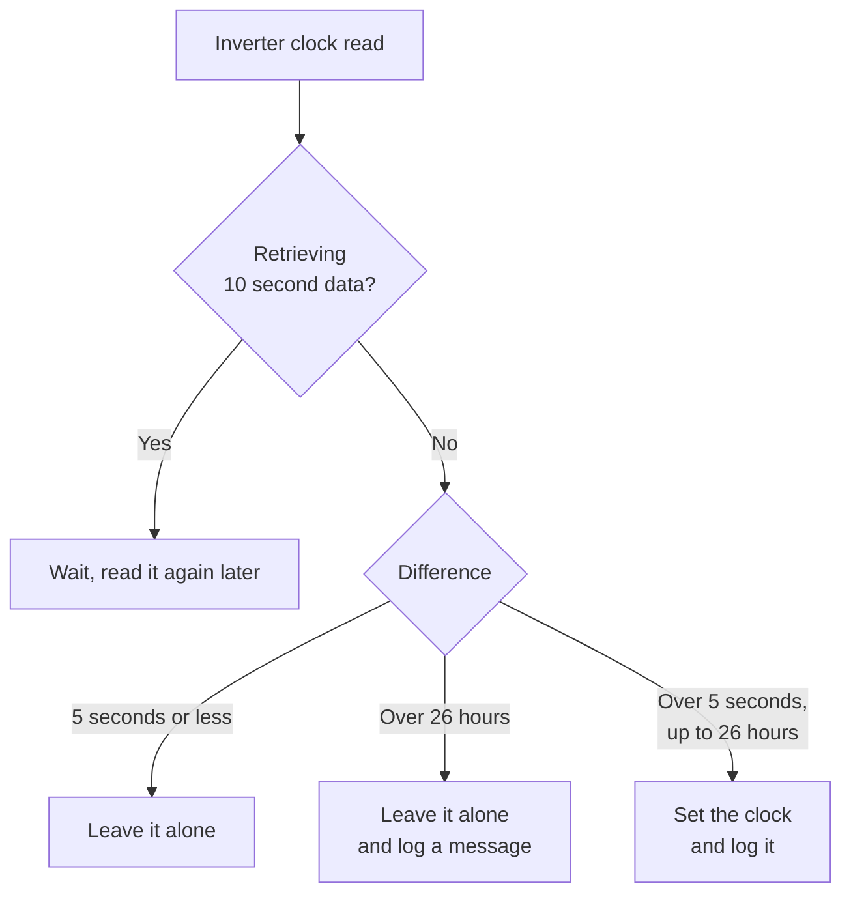

# How the inverter's clock is updated

An Aurora inverter's clock holds local wall-clock time. It knows nothing about time zones or daylight saving, and it drifts. Aurora Monitor can correct it in two ways:

| | Set by hand | Automatic sync |
|---|---|---|
| **Where** | Inverter → Set inverter time | Settings → Inverter → Sync inverter clock to computer time |
| **Sets the clock to** | A date and time you enter, or computer time | Computer time |
| **Limits** | None, it always writes | Only writes if the difference is over 5 seconds and no more than 26 hours |
| **Default** | | Never |

With two inverters, the menus show Inverter A and Inverter B, and each has its own sync setting.

## Automatic sync

### When it checks

Choose Never, Every hour, Every 6 hours, Every day or Every week. Unless it's set to Never, the program looks at the inverter's clock:

- at the chosen interval
- at program start
- when the difference between local time and UTC changes, which is what a daylight saving change looks like
- soon after you change the setting

`ScheduleClockCheck()` decides this once a minute, but only when the inverter is responding. A check that falls due while the inverter is asleep waits until it wakes.

### How a daylight saving change is detected

The program has no table of change dates. It asks the operating system for the current difference from UTC, in `GetGmtOffset()` and `src/gmt_offset.h`, and compares that with the last value. In London that value goes from `0` to `3600` when summer time starts.

A change only makes the program check straight away. The clock is corrected because it's now about an hour out, by the same rules as any other difference. A change of time zone in the computer's settings has the same effect.

This depends on the computer's time zone being correct.

### What it does with the result

The next poll reads the inverter's clock. `CheckInverterClock()` then acts on the difference:



The reasons for these rules:

- **5 seconds:** this avoids writing to the inverter for a difference too small to matter. The limit is `CLOCK_TOLERANCE` in `src/auroramon.h`.
- **26 hours:** a larger difference more likely means the computer's clock is wrong, so it needs a person to look at it. The limit is `CLOCK_MAX_CHANGE`.
- **10 second data:** retrieved data is converted to computer time using the clock difference, so that difference mustn't change during a retrieval.

### If setting the clock fails

Each failure is logged, with no message box, because this can run unattended. The program then tries again:

1. **At the next poll:** this reads the clock again and makes the decision again, up to 3 attempts in all (`CLOCK_SET_ATTEMPTS`). Attempts were about 13 seconds apart in testing. Each attempt sends the message up to 3 times.
2. **In about an hour:** after 3 failed attempts it waits, then starts a new check with 3 more attempts (`CLOCK_RETRY_WAIT`). A shorter sync interval still applies, so Every hour isn't delayed. This repeats until it works.

Reading the clock before each attempt handles a lost reply. If the inverter took the new time but its answer never arrived, the clock now looks right, so it isn't written again and the log says `clock is now correct`.

An inverter that's asleep doesn't use up attempts, because nothing is written until it answers a poll. A daylight saving change or a program start also begins a new check.

## How the clock is written

`SetInverterTime()` in `src/comms.cpp` does the following for both methods:

1. Takes the time to set, which is computer time plus any offset from the Set Time dialog.
2. Adds the difference from UTC **at that time**, so a date in the other daylight saving period is right.
3. Subtracts 1 January 2000, because the inverter counts seconds from then (`TimeBase`).
4. Adds 1 second to allow for the delay in sending.
5. Sends message 71, with the value as 4 bytes, most significant first.
6. Reads the clock back with message 70, and stores the new difference.

## Checking what happened

Automatic sync writes these to the **Message log** (Logs → Message log, or `system/message_log.txt` in the data directory):

| Message | Meaning |
|---|---|
| `Inverter #2: clock differs from computer time by 120 seconds, setting it` | A difference was found, and the set was queued |
| `Inverter #2: clock set to computer time` | The set worked |
| `Inverter #2: failed to set the clock, trying again` | An attempt failed, and it will try again at the next poll |
| `Inverter #2: failed to set the clock after 3 attempts, will try again in about an hour` | All 3 attempts failed |
| `Inverter #2: clock is now correct` | An attempt looked as if it failed, but the inverter did take the new time |
| `Inverter #2: clock differs from computer time by 100000 seconds. Not changed, use Inverter->Set inverter time` | The difference is over 26 hours |

The number is the inverter's time minus computer time, so a positive value means the inverter is ahead. If the set worked, `system/com_log.txt` shows the result in a line such as `difference is now 1`.

The Set Time dialog also shows both clocks, and Inverter → Inverter information shows the difference.

## Things to know

- **The computer is the reference.** A wrong computer clock is copied to the inverter if it's within 26 hours, so keep automatic time (NTP) on.
- **Live readings don't use the inverter's clock.** They're logged with computer time, so a wrong inverter clock mainly affects data retrieved from the inverter's memory.
- **With sync set to Never,** the program still reads the clock to find the difference, but never writes it.
- **Setting the time zone by hand:** a time zone entered in Settings → Location doesn't follow daylight saving for the sun charts. This doesn't affect the inverter's clock.
- **Effect on the inverter's own totals is unknown.** Nothing here has been tried on a real inverter, so compare the day's total after the first change. Daylight saving changes normally happen overnight while it's asleep, so this should be low risk.

## Testing

All of this has been tested against a simulator, not a real inverter:

| | Linux | Windows |
|---|---|---|
| UTC offset around daylight saving changes | Tested | Tested |
| Sync decisions and writing the clock | Tested with the simulator | Not tested, the serial port hasn't been run |

To try it on Linux, set the Serial Port in Settings → Setup to `/tmp/ttyAurora`, and start the simulator with its clock 2 minutes out:

```sh
python3 tests/fake_inverter.py --link /tmp/ttyAurora --addr 2 --clock-error 120 --log requests.txt
```

`--log` records each request, so message 71 in `requests.txt` shows each write. `--clock-drift` makes the clock gain time steadily, for testing regular syncs. `--fail-sets` and `--lose-set-replies` test failures. To test the wait after 3 failed attempts without waiting an hour, build with a shorter wait: `make CXXFLAGS="-O2 -DCLOCK_RETRY_WAIT=40"`.

To test a daylight saving change without waiting for one, start the program with a `TZ` rule that changes shortly after it starts. For example, this ends daylight saving at 14:30:00 local time on day 306 of the year. Change the day and time to just ahead of now (`date +%j` shows today's day number):

```sh
TZ='XST0XDT-1,J1/0,J306/14:30:00' src/auroramon
```

The Windows build workflow runs `tests/windows_gmt_offset.ps1`, which compares the UTC offsets with the Windows time zone data.
